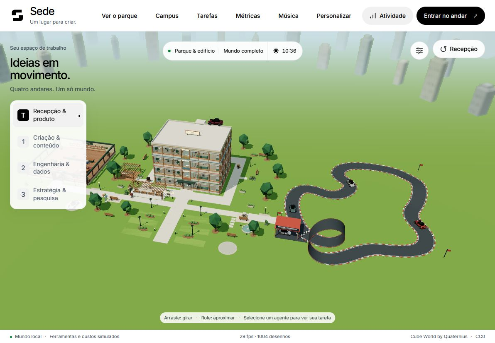

# Sede — Campus 3D experimental

Uma sede virtual em estilo voxel/chibi: quatro andares, agentes circulando, café, pub, um parque e carros que voam. Projeto de teste em beta, desenvolvido com JavaScript e Three.js.



## Rodar localmente

Requer **Node.js 22 ou superior**, navegador com WebGL e aceleração de hardware habilitada. A experiência foi pensada para desktop, mouse e teclado.

```sh
git clone https://github.com/NicolasRibeiro-Red/Sede.git
cd Sede
npm start
```

Abra **http://127.0.0.1:59159/sede-3d/**. Não é necessário instalar pacotes: os recursos da cena e o Three.js estão incluídos. O servidor aceita conexões somente neste computador; `Ctrl+C` encerra.

Se a porta estiver ocupada, use outra. No PowerShell:

```powershell
$env:PORT = '59160'
npm start
```

## O que experimentar

- Visão de maquete ou passeio em primeira pessoa, salas, portas e elevador.
- Personagens com aparência personalizável, acessórios e rotinas de trabalho e descanso.
- Campus com ciclo de dia e noite, iluminação, café e pub; visitantes chegam de carro, caminham e partem.
- Pista com curvas e loop, câmera traseira, voo e giro lateral.
- Café e bebidas com animação; uma habilidade cartunesca opcional com reações exageradas e retorno dos NPCs à rotina.
- Painel de atividade por agente, modelo, projeto e período, além de quadros dentro do escritório.

## Controles

| Contexto | Controles |
| --- | --- |
| Maquete | Arrastar para girar; roda do mouse para aproximar |
| Primeira pessoa | WASD ou setas para andar; arrastar ou Q/E para olhar; Shift acelera; F interage; Esc volta à maquete |
| Habilidade opcional | P equipa/guarda; clique ou Espaço dispara; R recarrega |
| Carro | WASD ou setas dirige; Espaço freia; Shift acelera; V alterna voo/pouso; E/Q sobe/desce; B faz giro lateral; L solicita loop; R retorna aos boxes; Esc sai após pousar |

Os botões e instruções na tela mostram as ações disponíveis no contexto atual. O menu de caminhada permite ajustar velocidade e câmera.

## Simulação e integrações

**Agentes, ferramentas, tarefas e métricas são simulados.** Os custos, tokens, horas e entregas servem para demonstrar a interface; não representam uso ou cobrança reais de modelos.

O compositor de tarefas produz um texto para copiar e executar manualmente em uma ferramenta externa, como o Codex. Esta beta não cria processos, conecta agentes, chama APIs de IA ou executa comandos no computador.

O player de música aceita links do Spotify e YouTube Music e usa os players incorporados oficiais. Reprodução, disponibilidade, login e restrições de autoplay dependem desses serviços e do navegador. Música é opcional; o campus funciona sem ela. Personalização, rascunhos e favoritos ficam no armazenamento local do navegador.

## Estrutura e verificação

- `sede-3d/`: cena, interface e comportamento.
- `cube-world-lab/`: personalização, modelos e dependências gráficas locais.
- `server.mjs`: servidor estático local sem dependências.
- `tests/`: verificações do pacote e do servidor.

```sh
npm test
```

Os testes verificam sintaxe, referências locais, integridade dos modelos e acesso HTTP. Eles não substituem avaliação visual, testes de desempenho ou compatibilidade em cada GPU. A beta usa movimentação e colisões simplificadas, não uma simulação física completa.

## Créditos e licenças

Modelos **Cube World Kit**, de **Quaternius** (CC0), biblioteca **Three.js** (MIT) e fonte **Inter** (SIL OFL). As licenças e a origem dos recursos estão preservadas; veja [THIRD_PARTY_NOTICES.md](THIRD_PARTY_NOTICES.md).

Este repositório é público, mas ainda não atribui uma licença de software livre ao código original da Sede. As licenças dos componentes de terceiros se aplicam aos respectivos arquivos. Nomes de produtos aparecem apenas como referências do protótipo, sem afiliação ou endosso.
